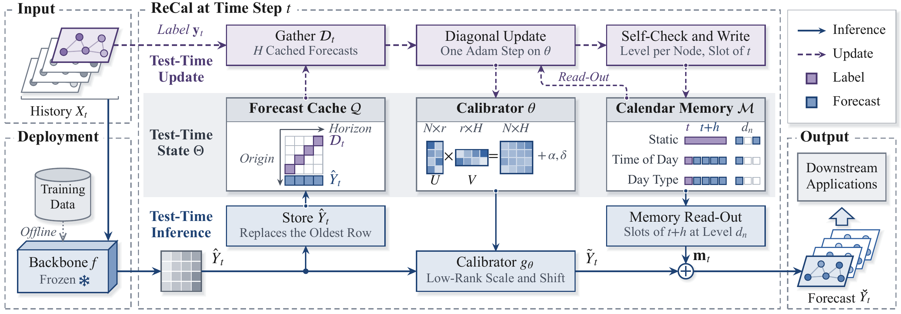

# RECAL

Code for **RECAL: Test-Time Calibration of Spatio-Temporal Forecasters on the Forecast Lattice**.

## Framework

RECAL calibrates frozen forecasters through low-rank correction, diagonal updates and hierarchical calendar memory.



## Datasets

Experiments cover 12 datasets across eight settings.

| Setting | Dataset | Interval | Nodes | Test days | Shift |
| --- | --- | --- | ---: | ---: | --- |
| Small-scale | PEMS | 5 min | 170–883 | 12–20 | Temporal |
| Small-scale | PEMS-BAY | 5 min | 325 | 36 | Temporal |
| Large-scale | LargeST | 15 min | 716–8,600 | 73 | Temporal |
| Long-horizon | LargeST | 15 min | 716–2,352 | 71–73 | Temporal |
| Out-of-distribution | LargeST | 15 min | 716–2,352 | 4 × 73 | Spatio-temporal |
| Continual | PEMS-Stream | 5 min | 655 → 871 | 6 | Network growth |
| Continual | Air-Stream | 1 h | 1,087 → 1,202 | 70 | Network growth |
| Continual | Energy-Stream | 10 min | 103 → 134 | 12 | Network growth |
| Few-shot | PEMS | 5 min | 170–883 | 12–20 | Temporal |
| Zero-shot | PEMS | 5 min | 170–883 | 12–20 | Unseen network |
| Foundation models | LargeST | 15 min | 716–8,600 | 11 | No fine-tuning |

PEMS denotes PEMS03/04/07/08; LargeST includes SD, GBA, GLA and CA.

Download the prepared PEMS and PEMS-BAY data from [ST-TTC](https://github.com/Onedean/ST-TTC), the large traffic networks from [LargeST](https://github.com/liuxu77/LargeST), and the continual streams from [EAC](https://github.com/Onedean/EAC).

## Environment

The conventional forecasting settings use:

```text
Python           3.11
PyTorch          2.2.1
NumPy            1.26.4
torch-geometric  2.5.3
easydict         1.10
timm             0.6.7
```

Other packages are listed in [requirements.txt](requirements.txt). Foundation models use separate environments with `timesfm==2.0.2`, `uni2ts==2.0.0`, or the Kairos source with `transformers==4.56.2`.

## Repository structure

```text
RECAL/
├── assets/
│   └── framework.png
├── recal/                    # Shared calibration method
├── scenarios/                # Each scenario contains a run.py entry
│   ├── small_scale/
│   ├── large_scale/
│   ├── long_horizon/
│   ├── out_of_distribution/
│   ├── continual/
│   ├── few_shot/
│   ├── zero_shot/
│   └── foundation_models/
├── .gitignore
├── LICENSE
├── README.md
└── requirements.txt
```

## Acknowledgement

We thank the following projects for their code and datasets:

- ST-TTC [[repo]](https://github.com/Onedean/ST-TTC)
- EAC [[repo]](https://github.com/Onedean/EAC)
- LargeST [[repo]](https://github.com/liuxu77/LargeST)
- STONE [[repo]](https://github.com/PoorOtterBob/STONE-KDD-2024)
- BasicTS [[repo]](https://github.com/GestaltCogTeam/BasicTS)
- TimesFM [[repo]](https://github.com/google-research/timesfm)
- Moirai / Uni2TS [[repo]](https://github.com/SalesforceAIResearch/uni2ts)

## License

[Apache-2.0](LICENSE). Third-party code retains its original license notices.
